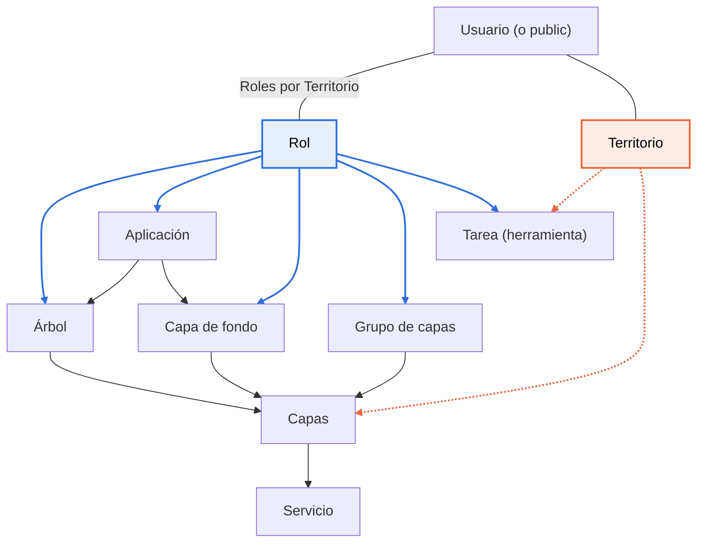

# De cero al primer proyecto

Al terminar tendrás un visor público funcionando: mapa de fondo, capas en un árbol y herramientas básicas, accesible para cualquier persona.

Esta guía es para quien entra por primera vez en el administrador. No hace falta programar, pero sí saber qué es un WMS.

**Necesitarás:**

- Un usuario con la opción **Usuario administrador de SITMUN** activada.
- La URL de un WMS con tus capas y la de un servicio para el mapa de fondo (WMS o WMTS).
- El territorio del proyecto y su sistema de coordenadas (por ejemplo, `EPSG:25831`).

La guía sigue ocho pasos en orden: cada uno depende de los anteriores.

## Conceptos básicos

Una **aplicación** es el proyecto que ve el usuario en el visor. No contiene las capas directamente: las toma de piezas que se crean por separado y que se enlazan entre sí.

| Concepto | Menú del administrador | Qué es |
| --- | --- | --- |
| Servicio | Servicio | Un servidor de mapas externo (WMS, WMTS, WFS) y su URL. |
| Capa | Capas | Una o varias capas de un servicio, con nombre, escalas y transparencia. En SITMUN también se llama «cartografía». |
| Grupo de capas | Permisos sobre las capas | Un conjunto de capas que se da a uno o varios roles. |
| Capa de fondo | Capas de fondo | Un mapa base que el usuario elige en el selector de mapas de fondo. |
| Árbol | Árboles | La lista de carpetas y capas que el usuario ve en el panel de capas. |
| Tarea | Tarea | Una herramienta del visor (buscador, impresión, medición, leyenda...). |
| Territorio | Territorios | La zona geográfica donde se usa la aplicación (municipio, comarca...). |
| Rol | Rol | Un perfil de permisos. Decide quién ve qué. |
| Usuario | Usuario | Una persona que entra en el visor o en el administrador. El usuario `public` representa a los visitantes sin sesión. |

**La idea clave:** un usuario solo ve algo si le llega a través de un **rol** y, en el caso de capas y tareas, si además está disponible en su **territorio**. Si falta una de estas dos conexiones, el elemento no aparece en el visor y no se muestra ningún error.

*Flechas azules gruesas: el rol da acceso. Flechas naranjas discontinuas: debe estar disponible en el territorio. Flechas grises: incluye o usa.*

La aplicación incluye mapas de fondo y árboles; los mapas de fondo, los grupos y los árboles apuntan a capas; las capas vienen de un servicio. Las capas y las tareas necesitan los dos enlaces: el rol y el territorio.

## Primera entrada en el administrador

El administrador se abre en `http://<servidor>/admin` (en una instalación local, `http://localhost:9000/admin`).

1. Elige el **Idioma** en la pantalla de inicio.
2. Escribe **Usuario** y **Contraseña** y pulsa **Iniciar sesión**. En una instalación nueva el usuario es `admin` y la contraseña `admin`: cámbiala el primer día.
3. Solo pueden entrar los usuarios con la opción **Usuario administrador de SITMUN** activada.

**El menú lateral** está agrupado en el orden de trabajo de esta guía:

| Grupo | Entradas |
| --- | --- |
| 1 | Cuadro de mando |
| 2 | Conexión, Servicio, Capas, Árboles, Capas de fondo |
| 3 | Permisos sobre las capas, Territorios, Rol, Usuario |
| 4 | Grupo de tareas, Tarea (con 9 tipos de tarea) |
| 5 | Aplicación |
| 6 | Sistema (solo para el usuario `admin`): Controles de interfaz de tarea, Idiomas, Traducciones de literales, Tipos de territorio, Tipos de tareas, Valores de listas de códigos, Parámetros de configuración |

**Cómo funcionan las pantallas.** Cada entrada del menú abre una **lista**. El botón **Nuevo** abre un formulario vacío; al hacer clic en una fila se abre su formulario.

- La primera pestaña del formulario siempre es **Información general**. Las demás pestañas enlazan ese elemento con otros (capas, roles, territorios...).
- En las pestañas de relación se usan los botones **Añadir** y **Eliminar**.
- No se guarda nada hasta que pulsas **Guarda**. Esto incluye los cambios de todas las pestañas.
- **Duplicar** crea una copia, útil para partir de un elemento que ya funciona.

!!! tip "Los botones son iconos"
    Los botones **Nuevo**, **Añadir**, **Eliminar**, **Duplicar**, **Registrar** y **Guarda** son iconos sin texto.
    Su nombre aparece al pasar el ratón por encima.

**A partir de aquí empezamos a crear el visor público.** Los pasos 1 a 8 lo montan sobre el usuario `public` (ya existe por defecto), un rol nuevo y una aplicación no privada.

## Paso 1: territorio, rol y usuario público

Este paso va primero porque casi todo lo demás (capas, mapas de fondo, árboles, tareas) se enlaza a un rol y a un territorio. El usuario `public` ya existe: solo hay que crear el territorio y el rol y asignárselos.

**1.1 Territorio** (menú **Territorios** → **Nuevo**)

- **Nombre**, **Código** y **Tipo** son obligatorios. Los tipos (Ayuntamiento, Diputación, Comarca...) ya existen; si falta alguno, se crea en **Sistema** → **Tipos de territorio**.
- Desactiva **Territorio bloqueado**. Un territorio nuevo aparece bloqueado por defecto.
- Rellena la **Extensión** (min X, max X, min Y, max Y; las cuatro juntas), el **CRS** (por ejemplo `EPSG:25831`) y, si quieres, el **Punto central** y el **Nivel de Zoom por defecto**. Estos valores mandan sobre los de la aplicación.

**1.2 Rol** (menú **Rol** → **Nuevo**)

- Solo hace falta el **Nombre**. Elígelo pensando en quién lo usará, por ejemplo «Rol público Ciutadella».

**1.3 Usuario público** (menú **Usuario**)

- Abre el usuario `public` (ya existe, no hay que crearlo), ve a la pestaña **Roles por Territorio**, pulsa **Añadir** y elige el rol del paso 1.2 y tu territorio.
- La columna **Rol territorial** hace que el rol valga también para los territorios hijos (por ejemplo, los municipios de una isla). Déjala desactivada si no lo necesitas.

Cada fila de **Roles por Territorio** es una llave: dice «esta persona, en este territorio, tiene este rol».

## Paso 2: dar de alta los servicios

Un servicio es la dirección de un servidor de mapas. Crea uno por cada servidor: uno para las capas de trabajo y otro para el mapa de fondo, si vienen de sitios distintos.

(menú **Servicio** → **Nuevo**)

1. **Título del servicio**: un nombre que reconozcas. El usuario del visor no lo ve.
2. **Tipo de servicio**: WMS, WMTS o WFS.
3. **Endpoint del servicio**: la URL base, sin parámetros (sin `?SERVICE=WMS&REQUEST=...`). Algunos servidores necesitan una barra `/` al final.
4. Si es WMS, pulsa **Obtener detalles del servicio**. El administrador pide al servidor su descripción (GetCapabilities) y rellena datos como la descripción y los metadatos. Si falla, la URL no es correcta o el servidor no responde.
5. **Método de autenticación**: deja **Ninguno** si el servicio es público. Si pide usuario y contraseña, elige **Autenticación HTTP básica** y rellénalos. La opción **Usar proxy SITMUN** se activa sola, porque el visor tiene que pasar por el servidor intermediario (proxy) de SITMUN para no exponer la contraseña.
6. Pulsa **Guarda**.

**Si el mapa de fondo es WMTS**, ve a la pestaña **Parámetros de configuración** y añade `matrixSet` y `format` (por ejemplo `image/png`). Sin estos dos valores el visor no puede dibujar el mapa de fondo.

La pestaña **Monitorización** tiene un botón **Probar acceso** para comprobar que el servidor responde.

## Paso 3: crear las capas

Hay dos maneras de crear capas. La primera es la más rápida cuando el servicio es WMS.

**Opción A: desde el servicio (WMS)**

1. Abre el servicio y ve a la pestaña **Capas**.
2. Pulsa **Actualizar capas del servicio** (en un servicio que aún no has guardado, el botón se llama **Obtener capas del servicio**). Aparece la lista de capas que ofrece el servidor, marcadas como **Capa no registrada**.
3. Selecciona las que quieras, pulsa **Registrar** y después **Guarda**. Se crea una capa de SITMUN por cada una, ya disponible para los clientes.

**Opción B: a mano** (menú **Capas** → **Nuevo**)

- **Nombre**: el que verá el usuario si la capa no está en un árbol (por ejemplo, en el selector de mapas de fondo).
- **Servicio**: el del paso 2.
- **Capa o capas del servicio utilizadas**: el nombre técnico de la capa en el servidor. Si pones más de una, separadas por comas, se dibujan juntas como una sola capa.
- Opcional: **Escala mínima** y **Escala máxima**, **Transparencia** (0 = opaca), si se puede consultar (GetFeatureInfo) y el **Orden** de dibujo.

**Dos comprobaciones obligatorias para cada capa:**

- [ ] La opción **Capa disponible para su uso por parte de los clientes** está activada. En una capa creada a mano aparece desactivada, y entonces el visor no la recibe.
- [ ] En la pestaña **Territorios** está el territorio del paso 1. Sin esto la capa no se muestra en ese territorio.

Esto vale también para las capas que usarás como mapa de fondo en el paso 4.

## Paso 4: grupos de capas y capas de fondo

Un grupo de capas es la manera de dar capas a un rol. Sin grupo, ningún rol tiene acceso a las capas del paso 3.

**4.1 Grupo de capas de trabajo** (menú **Permisos sobre las capas** → **Nuevo**)

1. **Nombre**, y **Tipo** = **Grupo de cartografía**.
2. Pestaña **Capas**: añade las capas de trabajo.
3. Pestaña **Roles**: añade el rol del paso 1.
4. **Guarda**.

Otros tipos de grupo: **Mapa de situación** (el mapa pequeño de referencia en la esquina, que se elige en la aplicación) e **Informe**.

**4.2 Capa de fondo** (menú **Capas de fondo** → **Nuevo**)

1. **Nombre** y, si quieres, una **Imagen** de miniatura (una URL).
2. Activa **Activo**. Una capa de fondo nueva aparece inactiva y el visor no la muestra.
3. Pestaña **Capas**: añade la capa o capas que forman el mapa de fondo.
4. Pestaña **Roles**: añade el rol del paso 1.
5. **Guarda**. El administrador crea automáticamente un grupo de tipo **Mapa de fondo** con el mismo nombre; no hace falta crearlo a mano.

!!! tip "El nombre que ve el usuario es el de la capa"
    En el selector de mapas de fondo del visor aparece el **nombre de la capa** del paso 3, no el de la capa de fondo.
    Pon a esa capa un nombre claro para los usuarios.

Recuerda: las capas del mapa de fondo también tienen que tener el territorio en su pestaña **Territorios** (paso 3). Crea tantas capas de fondo como quieras ofrecer (por ejemplo, ortofoto y topográfico).

!!! example "Extra: OpenStreetMap como mapa de fondo"
    Si quieres ofrecer el mapa de OpenStreetMap, sigue la guía [Añadir OpenStreetMap como mapa de fondo](mapa-fondo-openstreetmap.md).

## Paso 5: construir el árbol de capas

El árbol es lo que el usuario ve en el panel de capas: carpetas que contienen capas. Una capa solo aparece en el árbol si el usuario ya tiene acceso a ella por el paso 4.

(menú **Árboles** → **Nuevo**)

1. **Nombre** y **Tipo** = **Cartografía**.
2. Pestaña **Estructura del árbol**:
    - Añade una carpeta de primer nivel con el botón **Carpeta**. En el primer nivel solo puede haber carpetas.
    - Dentro de una carpeta puedes añadir más carpetas o capas. Una capa no puede tener hijos.
    - En cada nodo de capa, elige en **Cartografía** la capa del paso 3. El **Nombre** del nodo es lo que leerá el usuario (hasta 80 caracteres).
3. Opciones de cada nodo: **Visible**, **Cargar por defecto** (la capa aparece encendida al abrir el mapa), **Consultable (GetFeatureInfo)** (clic en el mapa para ver su información) y, en carpetas, **Modo selección única** (solo una capa encendida a la vez).
4. Pestaña **Roles**: añade el rol del paso 1. Sin rol, el árbol no llega a nadie.
5. **Guarda**. Los cambios en la estructura no se guardan hasta aquí.

**Atajo:** el botón **Cargar desde servicio** de la estructura crea las carpetas y las capas a partir de la organización del servicio WMS. Revisa el resultado antes de guardar: cada nodo tiene que quedar enlazado a una capa de SITMUN.

El árbol se enlaza a la aplicación en el paso 7.

## Paso 6: configurar las herramientas (tareas)

Cada herramienta del visor es una **tarea básica** enlazada a un control del visor. La instalación ya trae una tarea para cada control, dentro del grupo **Básico**. Normalmente no hace falta crear ninguna: solo hay que darlas al rol y al territorio.

(menú **Tarea** → **Tarea básica** → abre cada tarea que quieras)

1. Pestaña **Roles**: añade el rol del paso 1.
2. Pestaña **Territorios**: añade el territorio del paso 1.
3. **Guarda**.

Si falta el rol o el territorio, la herramienta no aparece en el visor.

**Herramientas mínimas para un primer proyecto:**

| Control | Para qué sirve |
| --- | --- |
| `sitna.layerCatalog` | Panel con el árbol de capas. **Sin esta tarea no se ve el árbol.** |
| `sitna.basemapSelector` | Selector de mapas de fondo. |
| `sitna.workLayerManager` | Lista de las capas encendidas. |
| `sitna.featureInfo` | Información de un punto al hacer clic en él. |
| `sitna.overviewMap` | Mapa de situación. |

Otros controles habituales: `sitna.search` (buscador) y `sitna.printMap` (impresión). Los demás tipos de tarea del menú (consulta, localizador, edición...) son para herramientas más avanzadas y quedan fuera de esta guía.

## Paso 7: crear la aplicación y juntarlo todo

La aplicación es el proyecto: dice qué mapas de fondo, qué árboles y qué roles forman el visor.

(menú **Aplicación** → **Nuevo**)

**Información general**

- **Nombre** y **Descripción** (obligatorios).
- **Tipo** = **Aplicación interna** (el visor de SITMUN). **Aplicación externa** solo guarda un enlace a otra web.
- **Título**: el texto de la cabecera del visor.
- **Estilo de mapa utilizado**: déjalo en blanco o pon `sitmun-base`.
- **CRS por defecto de la aplicación**: por ejemplo `EPSG:25831`. Si el territorio tiene CRS propio, manda el del territorio.
- **Mapa de situación**: opcional, un grupo de tipo **Mapa de situación** (paso 4). Si no eliges ninguno, se usa el primer mapa de fondo.
- **Aplicación privada**: déjala desactivada; si la activas, el usuario `public` no la ve.

**Pestañas**

1. **Roles**: añade el rol del paso 1. Es el enlace más importante: sin rol, nadie entra en la aplicación.
2. **Mapas de fondo**: añade las capas de fondo del paso 4 y ordénalas. La primera es la que aparece al abrir el mapa.
3. **Árboles**: añade el árbol del paso 5.
4. **Encabezado** (opcional): qué botones aparecen arriba (logotipo, cambio de territorio, idioma, salir...).
5. **Guarda**.

No hay pestaña de territorios: el territorio llega a través del usuario (paso 1).

Las opciones **Garantizar acceso al territorio de la asignación** y **Garantizar acceso a territorios hijo** solo importan si has activado **Rol territorial** en el usuario. En ese caso, la aplicación solo aparece si activas al menos una de las dos.

## Paso 8: comprobar el resultado en el visor

El administrador no tiene ningún botón para abrir el visor. Hay que abrirlo aparte, en otra pestaña del navegador.

- **Lista de aplicaciones:** `http://<servidor>/viewer/public/dashboard`. La aplicación nueva tiene que aparecer en la lista.
- **Directo al mapa:** `.../viewer/public/map/<id aplicación>/<id territorio>`. Los identificadores (id) aparecen en las listas del administrador.

En algunas instalaciones las direcciones llevan `#/` después de `/viewer` (por ejemplo `/viewer/#/public/dashboard`).

**Lista de comprobación**

- [ ] La aplicación aparece en la lista del visor.
- [ ] El mapa se abre centrado en el territorio.
- [ ] Se ve el primer mapa de fondo, y el selector de mapas de fondo muestra el resto.
- [ ] El panel de capas muestra el árbol con las carpetas y las capas.
- [ ] Las capas marcadas con **Cargar por defecto** aparecen encendidas.
- [ ] Al hacer clic en el mapa sobre una capa consultable aparece su información.
- [ ] Están las herramientas del paso 6.

Después de cambiar algo en el administrador, vuelve a cargar el visor. Si no ves el cambio, prueba en una ventana privada: el navegador puede tener guardada la configuración antigua.

## Problemas frecuentes

Casi siempre que algo no aparece en el visor es porque falta un enlace: un rol, un territorio o una opción activada. El visor no muestra ningún error.

| Qué pasa | Causa probable | Dónde se corrige |
| --- | --- | --- |
| La aplicación no aparece en la lista del visor | La aplicación no tiene el rol, o el usuario no tiene ese rol en ningún territorio. Si el usuario es `public`, quizá la aplicación es privada. | Aplicación → Roles; Usuario → Roles por Territorio |
| No aparece ningún mapa de fondo | La capa de fondo no está **Activo**, no tiene el rol, o sus capas no tienen el territorio. | Capas de fondo; Capas → Territorios |
| El mapa de fondo WMTS aparece en blanco | Faltan `matrixSet` o `format`. | Servicio → Parámetros de configuración |
| No se ve el panel de capas | La tarea `sitna.layerCatalog` no tiene el rol o el territorio. | Tarea básica → Roles / Territorios |
| Una capa no aparece en el árbol | La capa no está disponible para los clientes, no tiene el territorio o no está en ningún grupo con el rol. | Capas; Permisos sobre las capas |
| El árbol aparece vacío o no aparece | El árbol no tiene el rol, o ninguno de sus nodos tiene una capa que llegue al usuario. | Árboles → Roles |
| Las capas de un servicio con **Usar proxy SITMUN** no cargan | La dirección del servidor intermediario (proxy) es incorrecta. Pasa a menudo en copias de otra instalación. | Sistema → Parámetros de configuración → `proxy` |
| El nombre de una capa o aplicación no cambia en el visor | El visor muestra la traducción del idioma, no el campo original. | Sistema → Traducciones de literales |
| Después de **Cargar desde servicio** hay nodos sin capa | Algunos nodos no quedan enlazados a la capa al guardar. | Árboles → revisa cada nodo antes y después de guardar |

Si el problema continúa, prueba primero con el usuario `public` y una aplicación no privada. Es el camino con menos enlaces.

## Glosario

| Término | Significado |
| --- | --- |
| CRS | Sistema de coordenadas del mapa, escrito como `EPSG:` + número (por ejemplo `EPSG:25831`, UTM 31N). |
| Extensión | El rectángulo de coordenadas (min X, min Y, max X, max Y) que el mapa muestra al abrirse. |
| GetCapabilities | La petición que devuelve la descripción de un servicio y la lista de sus capas. |
| GetFeatureInfo | La petición que devuelve los datos de un punto cuando el usuario hace clic en el mapa. |
| Proxy | Servidor intermediario de SITMUN. El visor pasa por él para llegar a servicios protegidos. |
| Rol territorial | Opción de una asignación de usuario: el rol vale también para los territorios hijos. |
| Usuario `public` | Usuario que representa a cualquier visitante sin sesión. |
| WFS | Servicio que da los datos (geometría y atributos), no imágenes. |
| WMS | Servicio que da imágenes de mapa a demanda. |
| WMTS | Servicio que da imágenes de mapa ya cortadas en teselas. Es más rápido; se usa a menudo para los mapas de fondo. |
