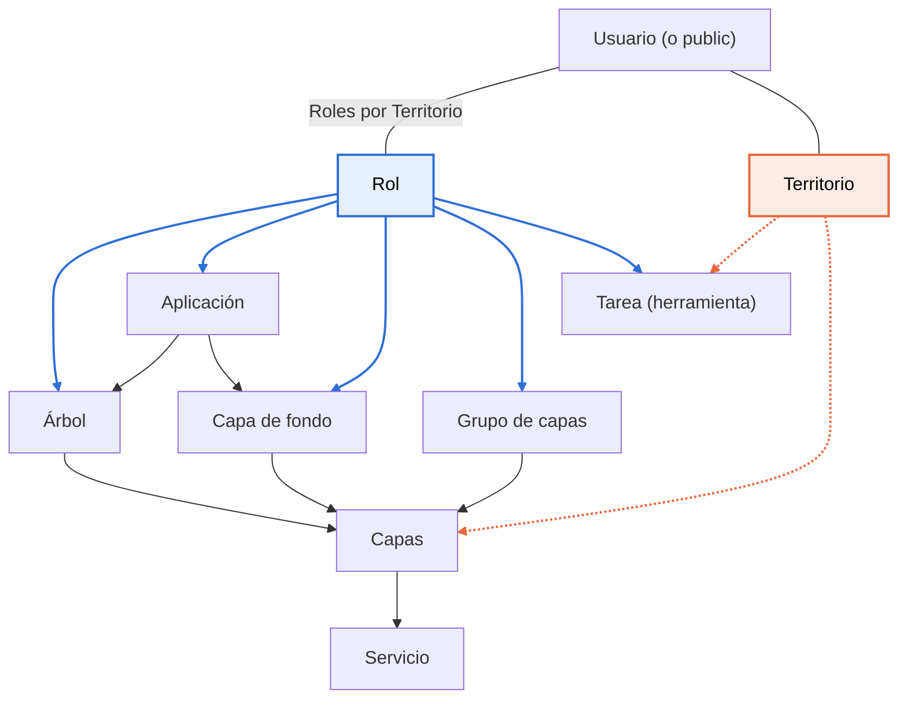

# De cero al primer proyecto

Al terminar tendrás un visor público funcionando: mapa de fondo, capas en un árbol y herramientas básicas, accesible para cualquier persona.

Esta guía es para quien entra por primera vez en el administrador. No hace falta programar, pero sí saber qué es un WMS.

**Necesitarás:**

- Un usuario con la opción **Usuario administrador de SITMUN** activada.
- La URL de un WMS con tus capas y la de un servicio para el mapa de fondo (WMS o WMTS).
- El territorio del proyecto y su sistema de coordenadas (por ejemplo, `EPSG:25831`).

La guía sigue ocho pasos en orden: cada uno depende de los anteriores.

## Conceptos básicos

Una **aplicación** es el proyecto que ve el usuario en el visor. No contiene las capas directamente: las toma de piezas que se crean por separado y que se enlazan entre sí.

| Concepto | Menú del administrador | Qué es |
| --- | --- | --- |
| Servicio | Servicio | Un servidor de mapas externo (WMS, WMTS, WFS) y su URL. |
| Capa | Capas | Una o varias capas de un servicio, con nombre, escalas y transparencia. En SITMUN también se llama «cartografía». |
| Grupo de capas | Permisos sobre las capas | Un conjunto de capas que se da a uno o varios roles. |
| Capa de fondo | Capas de fondo | Un mapa base que el usuario elige en el selector de mapas de fondo. |
| Árbol | Árboles | La lista de carpetas y capas que el usuario ve en el panel de capas. |
| Tarea | Tarea | Una herramienta del visor (buscador, impresión, medición, leyenda...). |
| Territorio | Territorios | La zona geográfica donde se usa la aplicación (municipio, comarca...). |
| Rol | Rol | Un perfil de permisos. Decide quién ve qué. |
| Usuario | Usuario | Una persona que entra en el visor o en el administrador. El usuario `public` representa a los visitantes sin sesión. |

**La idea clave:** un usuario solo ve algo si le llega a través de un **rol** y, en el caso de capas y tareas, si además está disponible en su **territorio**. Si falta una de estas dos conexiones, el elemento no aparece en el visor y no se muestra ningún error.

*Flechas azules gruesas: el rol da acceso. Flechas naranjas discontinuas: debe estar disponible en el territorio. Flechas grises: incluye o usa.*

La aplicación incluye mapas de fondo y árboles; los mapas de fondo, los grupos y los árboles apuntan a capas; las capas vienen de un servicio. Las capas y las tareas necesitan los dos enlaces: el rol y el territorio.

## Contenido de la guía

- [Primera entrada al administrador](primera-entrada.md)
- [Paso 1: territorio, rol y usuario público](paso-1-territorio-rol-usuario.md)
- [Paso 2: dar de alta los servicios](paso-2-servicios.md)
- [Paso 3: crear las capas](paso-3-capas.md)
- [Paso 4: grupos de capas y capas de fondo](paso-4-grupos-y-fondos.md)
- [Paso 5: construir el árbol de capas](paso-5-arbol.md)
- [Paso 6: configurar las herramientas (tareas)](paso-6-herramientas.md)
- [Paso 7: crear la aplicación y juntarlo todo](paso-7-aplicacion.md)
- [Paso 8: comprobar el resultado en el visor](paso-8-comprobar.md)
- [Problemas frecuentes](problemas-frecuentes.md)
- [Glosario](glosario.md)
